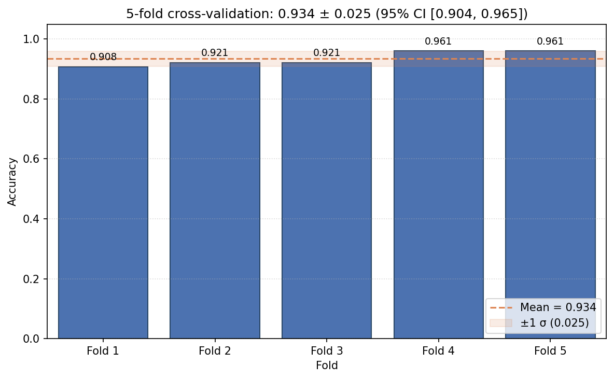
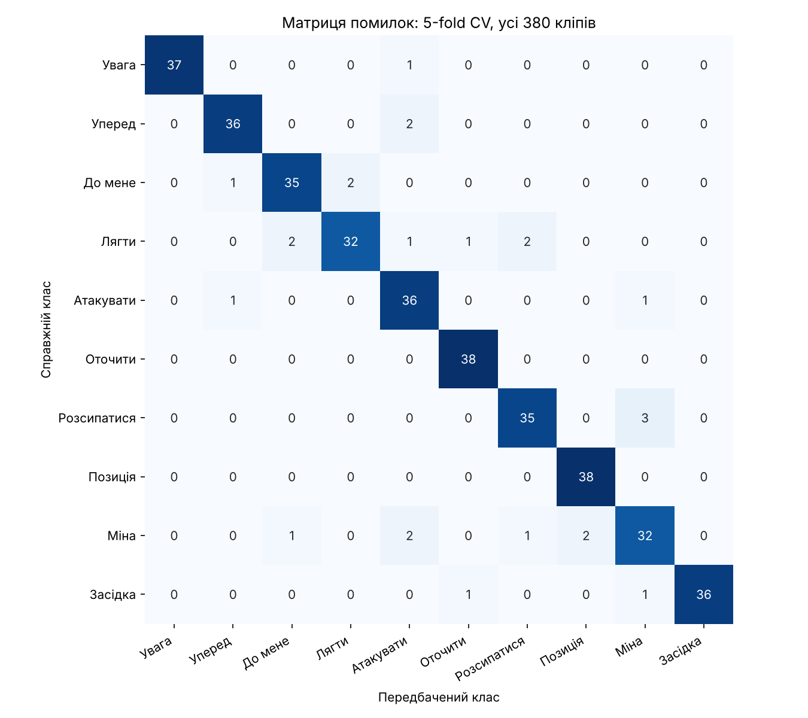

# Система розпізнавання тактичних жестових сигналів

Бакалаврська робота, КПІ ім. Ігоря Сікорського, ФПМ, 2026.
Авторка: Анастасія Ринкевич.

Система розпізнає тактичні жести ЗСУ з відеопотоку вебкамери і в реальному часі
перетворює їх на голосові команди. Працює повністю офлайн.

**Навіщо:** голосова команда демаскує позицію, а радіо вразливе до РЕБ. Жести
надійні, але отримувач мусить дивитися на того, хто їх показує, і відводити
погляд від свого сектора. Система знімає це обмеження.

## Результати

5-fold стратифікована крос-валідація на 380 кліпах (по 304 кліпи для навчання й 76 для валідації в кожному фолді):

| Метрика | Значення |
|---|---|
| Точність | **93,4% ± 2,5%** (95% ДІ: 90,4–96,5%) |
| Macro-F1 | **93,4%** |
| Час обробки одного кліпу (GPU T4) | **≈0,13 с** |
| Класів | 10 жестів |
| Датасет | 380 кліпів, зібраний і розмічений власноруч |





Найскладніший клас — «Міна» (середній F1 0,85), найчастіше її плутає з «Атакувати» та «Позицією».
Повні метрики й криві навчання для кожного фолду лежать у [`results/kfold/`](results/kfold/).

Обмеження: дані зняті в домашніх умовах, без камуфляжу, тактичних рукавиць і
ракурсу з нагрудної камери. Це прототип, наступний етап — польова валідація.

## Як це працює

```
вебкамера → кільцевий буфер (2 с) → 8 кадрів рівномірно → TimeSformer → ймовірності
         → EMA-згладжування → поріг впевненості → cooldown → WAV-команда
```

- **Модель:** [TimeSformer-Base](https://huggingface.co/facebook/timesformer-base-finetuned-k400),
  попередньо навчена на Kinetics-400. Голову замінено на 10 класів, донавчаються
  лише останні блоки енкодера (transfer learning).
- **Навчання:** AdamW з різними learning rate для голови та енкодера, cosine annealing,
  label smoothing, AMP, early stopping. Тренування на Google Colab (T4).
- **Оцінка:** 5-fold стратифікована крос-валідація, 95% довірчий інтервал за
  t-розподілом Стьюдента, precision/recall/F1 за класами, матриця помилок.
- **Потокова постобробка:** EMA (α = 0,3), поріг впевненості 0,7, інтервал
  блокування 2 с, щоб один жест не спрацьовував кілька разів.
- **Інтерфейс:** PyQt6, інференс в окремому потоці.

Класи жестів узято з навчальних відео каналу «Пантерівець»: увага, уперед,
до мене, лягти, атакувати, оточити, розсипатися, позиція противника, міна, засідка.

## Структура

```
config.py            — усі гіперпараметри (єдине джерело правди)
src/
  video_buffer.py    — потокобезпечний кільцевий буфер кадрів
  preprocessing.py   — підготовка кліпу для моделі
  model.py           — обгортка TimeSformer, заморожування блоків
  postprocessing.py  — EMA, поріг, cooldown
  audio.py           — неблокуюче відтворення команд
  inference.py       — потоковий інференс (CLI: відеофайл або вебкамера)
  train.py           — навчання
  train_kfold.py     — 5-fold крос-валідація
  evaluate.py        — метрики та графіки
gui/                 — десктопний інтерфейс PyQt6
tools/
  record_dataset.py  — запис датасету з вебкамери
  verify_dataset.py  — перевірка цілісності датасету
  profile_inference.py — замір latency (CPU / GPU)
  generate_audio.py  — генерація голосових команд (офлайн TTS)
notebooks/colab_train.ipynb — навчання на Colab T4
CLAUDE.md            — специфікація проєкту для Claude Code
.claude/skills/      — CV-скіл для агента
ROADMAP.md           — план роботи за фазами
```

## Як я працювала з ШІ

Код написаний разом із **Claude Code**. Архітектуру, вибір моделі, гіперпараметри
й методику оцінки визначала я, вони зафіксовані в математичному розділі диплома.

- **[CLAUDE.md](CLAUDE.md)** — специфікація для агента: математичні параметри, які
  не можна змінювати без узгодження, стек і заборонені бібліотеки, структура
  проєкту, стандарти коду та правила на кшталт «не вигадувати метрики».
- **[ROADMAP.md](ROADMAP.md)** — робота за фазами: реалізація → збір даних і
  навчання → оформлення диплома.
- **[computer-vision-engineer](.claude/skills/computer-vision-engineer/)** — додала
  з GitHub опис ролі CV-інженера, щоб агент дотримувався практик комп'ютерного зору.
- Спочатку в plan mode продумувала пайплайн, потім давала агенту невеликі
  задачі (~100–200 рядків) і перевіряла кожен модуль smoke-тестами.

## Запуск

```bash
pip install -r requirements.txt
python -m tools.generate_audio                              # згенерувати 10 WAV
python -m gui.main --checkpoint checkpoints/best_model.pt   # GUI
python -m src.inference --video clip.mp4 --audio            # CLI
```

Навчання (на Colab з GPU):

```bash
pip install -r requirements-colab.txt
python -m src.train_kfold      # 5-fold крос-валідація
python -m src.train            # фінальна модель
python -m src.evaluate         # метрики та графіки
```

Датасет і ваги моделі в репозиторій не входять: датасет містить відео людей,
а ваги важать сотні мегабайт.
